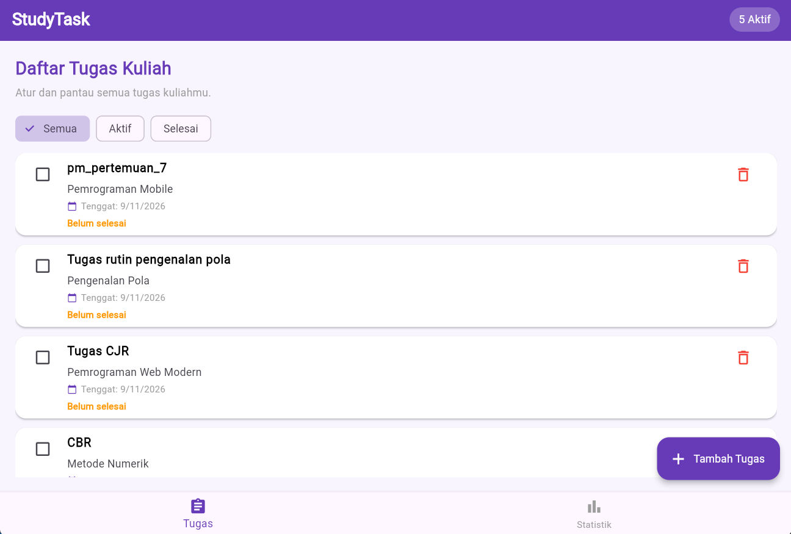
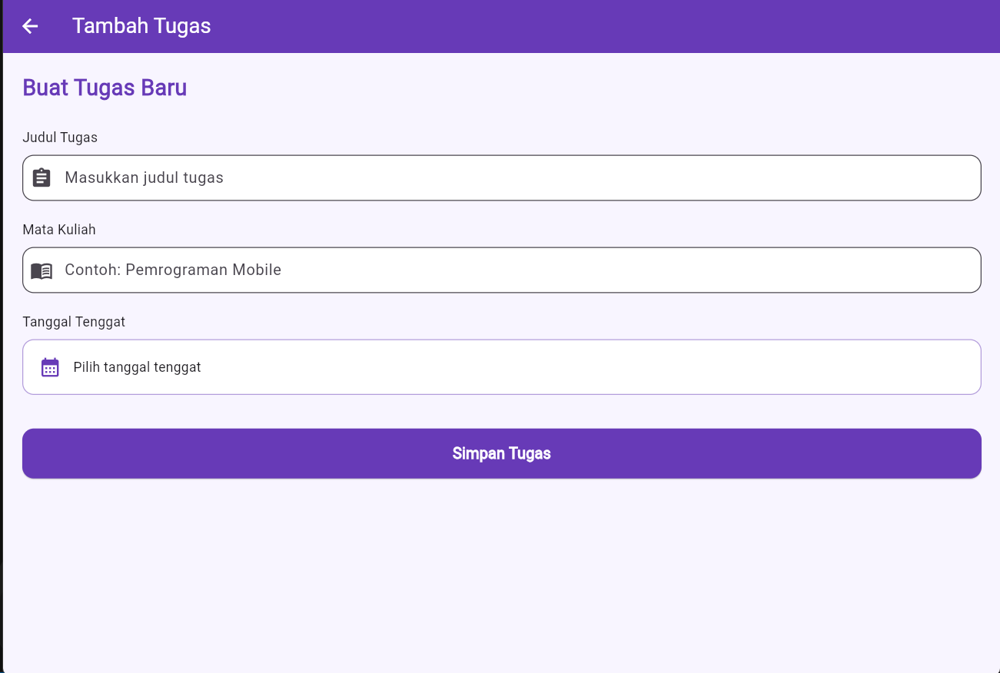
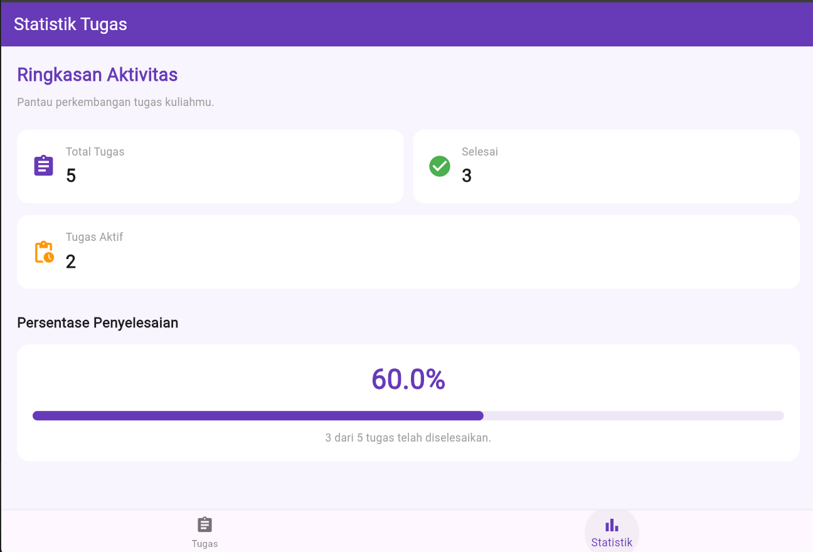

# Planner Tugas Kuliah

## Identitas
- Nama: Yusrida Jelianti Sihite
- NIM: 4243250048
- Kelas: PSIK 24C
- Mata Kuliah: Pemrograman Mobile
- Tugas: Tugas Rutin 7

## Deskripsi
Aplikasi pencatat tugas kuliah berdasarkan judul, mata kuliah, dan tenggat. Pengguna dapat menambah, menandai selesai, menghapus, memfilter tugas, dan melihat statistik.

## Teknologi
Flutter, Provider (`ChangeNotifier`), `setState`, `TextEditingController`, dan `go_router`.

## Screenshot
Simpan gambar pada folder `screenshots/` dengan nama berikut.

### Daftar tugas


### Tambah tugas


### Statistik


## Diagram state
```text
ChangeNotifierProvider (TaskProvider) – STATE BERSAMA
├── Daftar Tugas
│   ├── Data tugas dari Provider
│   └── Filter Semua/Aktif/Selesai – setState (LOKAL)
├── Form Tambah
│   ├── TextEditingController – lokal
│   └── Simpan data ke Provider
└── Statistik
    └── Total, selesai, aktif, persentase – Provider
```

## Lifecycle dan alasan memilih Provider (150–250 kata)
Aplikasi ini menggunakan Provider dengan `ChangeNotifier` untuk mengelola data tugas yang dipakai bersama oleh tiga halaman. Data disimpan di dalam `TaskProvider`, sehingga halaman daftar, form, dan statistik membaca sumber data yang sama. Ketika tugas ditambahkan, ditandai selesai, atau dihapus, Provider menjalankan `notifyListeners()` agar widget yang berlangganan memperoleh pembaruan. Provider dipilih karena konsepnya relatif sederhana untuk dipelajari, tidak memerlukan banyak struktur tambahan, dan sesuai untuk state bersama pada aplikasi berukuran kecil hingga menengah.

State filter Semua, Aktif, dan Selesai hanya digunakan oleh halaman daftar. Karena perubahan filter tidak perlu diketahui halaman lain, state tersebut dikelola secara lokal menggunakan `setState`. Pada `AddTaskScreen`, dua `TextEditingController` dibuat di dalam `initState()` agar controller tersedia selama objek State masih hidup. Controller digunakan untuk membaca input judul dan mata kuliah. Ketika halaman tidak lagi digunakan, metode `dispose()` dipanggil untuk melepaskan kedua controller agar sumber daya tidak tertinggal. Setelah validasi berhasil, form mengirim data ke `TaskProvider`, lalu kembali ke halaman daftar. Halaman statistik dan badge navigasi membaca Provider sehingga nilainya berubah otomatis saat data tugas berubah.

## Pengujian
Tiga unit test tersedia pada `test/task_provider_test.dart`: menambah tugas, menandai tugas selesai, dan menghapus tugas.

Jalankan:
```bash
flutter pub get
dart format lib test
flutter analyze
flutter test
flutter run
```

## Pernyataan penggunaan AI
AI digunakan sebagai alat bantu menyusun kerangka kode, memahami Provider dan lifecycle StatefulWidget, serta menyiapkan dokumentasi. Kode dipelajari, disesuaikan, dan diuji kembali oleh mahasiswa.
